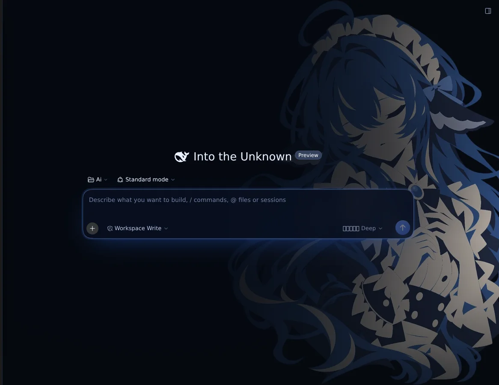
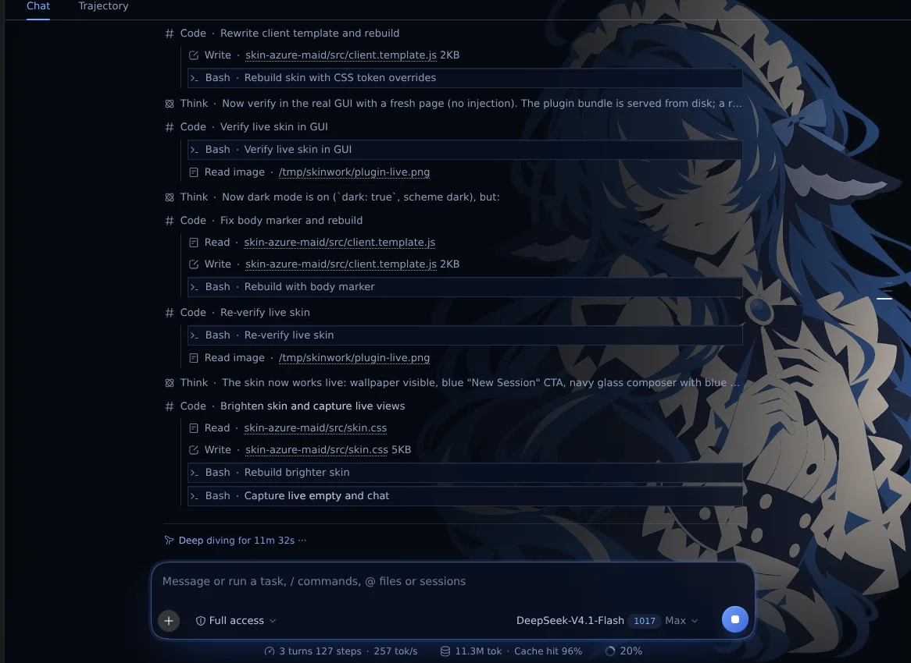

# Azure Maid — DSH Web 皮肤

深海军蓝磨砂玻璃、矢车菊蓝高光、右侧人物立绘壁纸。纯前端主题插件：一个空的宿主行加一段浏览器样式，不读取也不改写任何会话数据。

源码仓库：<https://github.com/XCF1132495344/dsh-skin-azure-maid>





## 特性

- 整页立绘壁纸，构建时内联为 data URI，运行时不产生额外网络请求
- 深色玻璃面板、蓝色主按钮、输入框聚焦光晕
- 自定义滚动条、文本选区、导航高亮
- 样式绑定在插件生命周期上：停用或卸载插件后，壁纸与配色一起撤销

## 安装

插件是一个 DSH 组合包（bundle），下面三种方式任选其一。

### 1. 从 npm 安装（发布之后）

侧边栏 **Plugins** → **添加插件** → 在「包名或地址」里填 `dsh-skin-azure-maid` → 安装。新组合包默认启用，刷新页面即可看到效果。

中国大陆网络下拉取 npm 官方源较慢时，在「添加插件」的「安装源」里选 **中国大陆镜像源**；命令行等价写法是 `dsh plugin --profile web add dsh-skin-azure-maid --registry=https://registry.npmmirror.com`。新发布的包同步到镜像通常需要几分钟。

### 2. 从本地 tgz 安装（还没发布时最省事）

把 `dsh-skin-azure-maid-1.0.0.tgz` 发给对方，在 **Plugins** → **添加插件**，在「包名或地址」里填 tgz 的绝对路径，例如 `/home/me/dsh-skin-azure-maid-1.0.0.tgz`。

### 3. 命令行

```sh
dsh plugin --profile web add dsh-skin-azure-maid
```

`dsh plugin` 只把包写进 profile 依赖，还需要把它选进组合包列表：编辑 `~/.dsh/profiles/web/package.json`，在 `dsh.profile.bundles` 末尾加入 `"dsh-skin-azure-maid"`；或者直接在 **Plugins** 页打开同名开关。之后重启 `dsh web`（启用 HMR 时会自动重组）。

## 生效与关闭

- 插件启用即全局生效，不需要在 **设置 → Appearance** 里选择主题。
- 暂时关闭：**Plugins** 页关闭该组合包，样式立即撤销。
- 与其他主题插件同时启用时，后加载的样式优先级更高；建议只开一个皮肤。

## 卸载

在 **Plugins** 页卸载，或：

```sh
dsh plugin --profile web remove dsh-skin-azure-maid
```

卸载后从 `dsh.profile.bundles` 中移除同名条目并刷新页面；壁纸与配色随样式表一起撤销。

## 兼容性

- DSH Web `0.2.1-rc.2` 及以上（`engines.dsh`）
- 仅支持 Web 端（`dsh.client.platform = web`）
- 皮肤通过 `_sidebarCol`、`_composer` 等 class 片段覆盖 DSH Web 样式；DSH 前端大改后可能需要同步选择器

## 包里有什么

| 路径 | 作用 |
| --- | --- |
| `index.js` | 宿主半身：空实现，只给 Loader 一个挂载入口 |
| `client.js` | 浏览器半身（构建产物）：注入皮肤样式并标记文档 |
| `cordis.patch.yml` | 组合包 patch：插入 `skin-azure-maid` 行 |
| `src/skin.css` | 皮肤样式源文件 |
| `src/theme.json` | 主题 token 覆盖 |
| `src/client.template.js` | `client.js` 的模板 |
| `assets/azure-maid.webp` | 壁纸原图（构建时内联） |
| `scripts/build.mjs` | 由源文件生成 `client.js` |

## 本地开发

```sh
node scripts/build.mjs
```

修改 `src/skin.css`、`src/theme.json` 或 `assets/azure-maid.webp` 后执行上面的命令重新生成 `client.js`。

## English

Azure Maid is a Web-only skin bundle for the DSH Web GUI: navy frosted glass, cornflower accents, and an illustrated wallpaper anchored to the right edge. Install it from the Plugins page (`dsh-skin-azure-maid`) or with `dsh plugin --profile web add dsh-skin-azure-maid`, then enable the bundle. It has no host-side behavior and does not touch session data.

## License

代码以 MIT 发布。`assets/azure-maid.webp` 为作者提供的插画，随包分发仅用于本皮肤。
